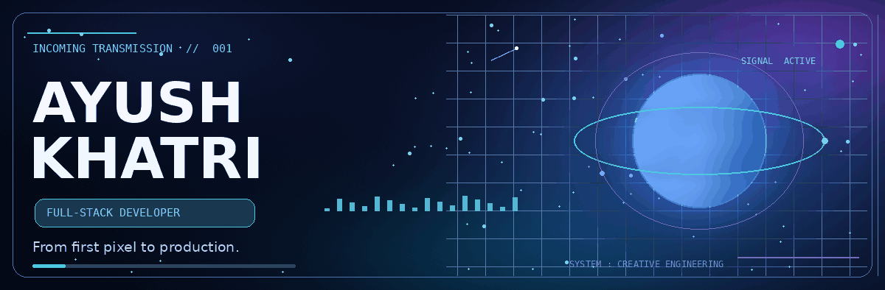
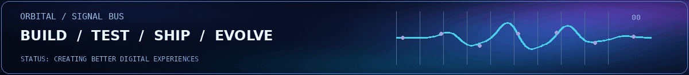
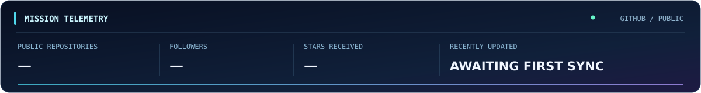

<!--
  A Y U S H  /  O R B I T A L   P R O F I L E
  Original motion assets live in ./assets/ and are generated by ./scripts/render_assets.py
  The GitHub README intentionally contains no JavaScript or custom CSS:
  GitHub's Markdown sanitizer strips both. All motion is rendered as GIF artwork.
-->

  

  <samp>✦ CURRENTLY TRANSMITTING FROM THE FULL-STACK UNIVERSE ✦</samp>
   
  <strong>Engineering functional applications, reliable backend systems, and experiences people actually enjoy using.</strong>
   
  Next.js &nbsp;·&nbsp; TypeScript &nbsp;·&nbsp; Node.js &nbsp;·&nbsp; PostgreSQL &nbsp;·&nbsp; India 🇮🇳

  
  
  
  

  
  
  

<!-- ==================== 01 / THE PERSON ==================== -->

### `01 / THE PERSON BEHIND THE TERMINAL`

I’m **Ayush Khatri**, a full-stack web developer who enjoys making the *entire* product work — not only the screen that people see. I care about crisp interfaces, sensible architecture, secure APIs, predictable data flows, and the small details that make an application feel considered.

My favorite projects begin with a concrete problem. I sketch the experience, turn the tricky parts into manageable systems, and keep refining until the result is something I would happily put into people's hands. I work primarily with **Next.js, TypeScript, Node.js, and modern databases**, and I like experimenting with AI-assisted development when it helps me think, test, and deliver better.

<table width="100%">
<tr>
<td width="33%" valign="top"><b>01 · EXPERIENCE</b> Interfaces should feel effortless. I build responsive, accessible UI with attention to hierarchy, motion, and detail.</td>
<td width="34%" valign="top"><b>02 · ENGINEERING</b> Good backends are boring in the best way: explicit contracts, sensible validation, and maintainable systems.</td>
<td width="33%" valign="top"><b>03 · SHIPPING</b> I care about the path from idea to release: iteration, testing, deployment, and what happens after launch.</td>
</tr>
</table>

<!-- ==================== 02 / THE STACK ==================== -->

### `02 / TECHNOLOGY CONSTELLATION`

<table width="100%">
<tr>
<td width="63%" valign="top">
<table width="100%">
<tr><th colspan="2" align="left">⚡ CORE ENGINEERING</th></tr>
<tr><th align="left">Domain</th><th align="left">Tools &amp; Technologies</th></tr>
<tr><td><b>Languages</b></td><td>HTML5, CSS3, JavaScript, TypeScript, C, C++</td></tr>
<tr><td><b>Frontend</b></td><td>Next.js, React.js, Tailwind CSS, shadcn/ui</td></tr>
<tr><td><b>Backend</b></td><td>Node.js, Express.js, Hono.js</td></tr>
<tr><td><b>Data &amp; State</b></td><td>PostgreSQL, MongoDB, Prisma, Redis, Zustand, React Query, Zod</td></tr>
<tr><td><b>Developer Tools</b></td><td>VS Code, Git, GitHub, Postman</td></tr>
</table>
</td>
<td width="2%">&nbsp;</td>
<td width="35%" valign="top">
<table width="100%">
<tr><th colspan="2" align="left">✦ AI COMMAND CENTER</th></tr>
<tr><th align="left">Assistants</th><th align="left">Coding Agents</th></tr>
<tr><td>ChatGPT</td><td>Codex</td></tr>
<tr><td>Claude</td><td>GitHub Copilot</td></tr>
<tr><td>Gemini</td><td>Claude Code</td></tr>
<tr><td>&nbsp;</td><td>Cursor</td></tr>
</table>
</td>
</tr>
</table>

<!-- ==================== 03 / WORK ==================== -->

### `03 / SELECTED MISSIONS`

<table width="100%">
<tr>
<td width="33%" valign="top"><b>🪐 LessonMap</b> Course-planning and lesson-structuring tools for people who teach, create, and share knowledge.  <a href="https://lessonmap.vercel.app/">Explore project ↗</a></td>
<td width="34%" valign="top"><b>🛰️ QChat</b> Real-time, room-based communication — exploring the systems and interfaces behind live conversation.  <a href="https://github.com/ayush-khatrii?tab=repositories&q=QChat">Find repository ↗</a></td>
<td width="33%" valign="top"><b>🌌 Portfolio</b> A continuously evolving place to present the projects, tools, and ideas behind my development work.  <a href="https://ayushkhatri.in">Visit website ↗</a></td>
</tr>
</table>

  

<!-- ==================== 04 / LIVE SIGNAL ==================== -->

### `04 / LIVE MISSION TELEMETRY`

Public GitHub API metrics · refreshed daily by GitHub Actions after initial setup · no fabricated counters

<!-- ==================== 05 / STATS DROPDOWN ==================== -->

### `05 / THE BLACK BOX — GITHUB ACTIVITY`

<b>🛰️ UNSEAL MISSION CONTROL — live stats, languages, contribution history &amp; activity</b>

 
<table width="100%">
<tr>
<td width="33%" align="center" valign="top"></td>
<td width="34%" align="center" valign="top"></td>
<td width="33%" align="center" valign="top"></td>
</tr>
<tr>
<td colspan="3" align="center"></td>
</tr>
</table>

<b>CONTRIBUTION FIELD</b>

<b>ACTIVITY ORBIT</b>

<!-- ==================== 06 / CLOSING ==================== -->

### `06 / OPEN FREQUENCY`

I’m interested in the overlap between **well-designed products**, **thoughtful engineering**, and **tools that solve actual problems**. If you're working on a product that needs both a good interface and a solid foundation, I’d love to hear what you're building.

  
  

DESIGNED TO BE EXPERIENCED · BUILT TO BE MAINTAINED · ALWAYS IN ORBIT

<!-- End of transmission. -->
